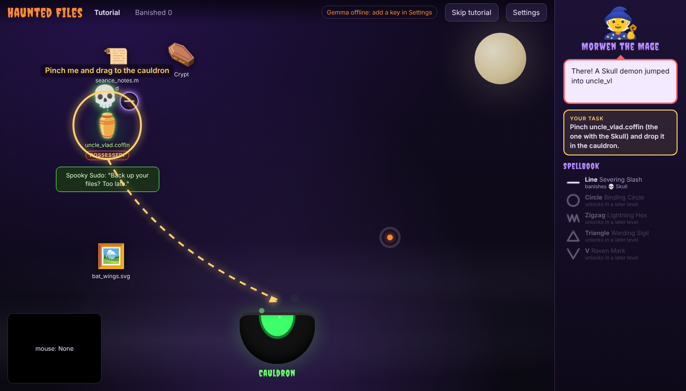

# Haunted Files

Demons are possessing the files on your desktop. You grab the infected files with your bare hands through the webcam, drop them into a cauldron and draw the banishing shape in the air. Gemma 4 looks at you through the camera to name each demon and taunt you.



## How to play

| Gesture | What it does |
|---|---|
| Pinch (thumb and index together) | Grab and drag a file or a window title bar. Pinch a button to press it. |
| Release the pinch | Drop into a folder, a window, the cauldron or anywhere on the desktop |
| Point one finger | Draw in the air. Lowering the finger ends the stroke. |
| Open palm, held 0.6 s | Open a file or folder, skip the mage's line, start the next level |
| Thumb up, held 1.2 s | Pause or resume |
| Open your mouth for 1 s | Banshee scream: every infection drops by 10 (20 s cooldown) |

The cleanse loop:

1. A demon flies into a file. The file shakes, glows green and cracks as its corruption rises.
2. Pinch the file and drop it into the cauldron before it hits 100% and turns into a tombstone. Past 60% it starts spreading to the nearest file.
3. The demon rises out of the cauldron with a shape above it: a line, circle, zigzag, triangle or V.
4. Point one finger and draw that shape within 8 seconds. Get it right and the demon is banished. Miss 3 times or run out of time and it escapes into another file.

Each monster is banished by one spell. The spellbook in the mage panel lists them, and new spells unlock as you level up:

| Draw | Spell | Banishes | Unlocks |
|---|---|---|---|
| Line | Severing Slash | 💀 Skull | Tutorial |
| Circle | Binding Circle | 👻 Wraith | Level 1 |
| Zigzag | Lightning Hex | 🎃 Pumpkin | Level 2 |
| Triangle | Warding Sigil | 😈 Imp | Level 3 |
| V | Raven Mark | 🦇 Bat | Level 4 |

When a demon is in the cauldron, a big glowing guide above it keeps redrawing the shape from an orange start dot, so you can copy it.

Morwen the Mage walks you through a tutorial, calls out what is happening and sends you to the next level. Each level brings more files, more demons, faster corruption and harder shapes.

No camera? The whole game works with a mouse: left drag is a pinch, right drag (or holding D) draws, holding P is an open palm and holding T is a thumb up.

## How Gemma 4 is used

Gemma 4 runs through the Gemini API, and only on single webcam snapshots, never on video frames. Hand and face tracking need about 30 updates a second, so a language model is the wrong tool for that. Gemma reacts to moments instead:

- **Possession.** When a demon lands in a file, the app sends Gemma a mirrored 384x288 snapshot and the file name. Gemma replies with a demon name (often a pun on the file) and a taunt that mentions something it can actually see, like your hoodie or the lamp behind you.
- **Level judgment.** When you clear a level, Gemma gets a snapshot and your stats (banished, lost, shape accuracy, fastest cleanse) and gives you a witch rank and a verdict, which the mage reads out.

The game never waits for Gemma. A demon starts as "???" and its name fills in when the answer arrives. With no key, or if a call fails, the app uses pre-written lines and shows a "backup scrolls" badge.

The prompts live in [`js/gemma.js`](js/gemma.js).

## Open-source stack

- **Gemma 4** (open weights) for demon names, taunts and judgments
- **MediaPipe Tasks Vision** (Apache 2.0) for hand landmarks, gesture labels and face blendshapes, running fully in the browser
- **The $1 Unistroke Recognizer** (Wobbrock, Wilson and Li, 2007), implemented in [`js/shapes.js`](js/shapes.js), for air-drawn shapes
- Plain HTML, CSS and JavaScript modules, with no build step and no dependencies to install

The gesture and shape layer is also packaged as an Agent Skill in [`skill/SKILL.md`](skill/SKILL.md) so other projects can reuse it.

## Run locally

```bash
python3 -m http.server 8000
```

Open http://localhost:8000 in Chrome. The camera only works on `localhost` or over HTTPS.

To turn on Gemma, click **Settings**, paste a Gemini API key from Google AI Studio, click **Find Gemma models** and save. The key is stored only in your browser's localStorage and is sent only to Google's Gemini API.

Add `?debug=shapes` to the URL to practice shapes and see the recognizer's scores.

## Deploy on DigitalOcean

**App Platform (easiest):** create an app from this GitHub repo, choose a **Static Site** component, leave the build command empty and set the output directory to `/`. App Platform serves it over HTTPS, so the camera works.

**Droplet:** on an Ubuntu droplet with a domain pointed at it, install Caddy and run:

```bash
caddy file-server --root /var/www/haunted-files --domain yourdomain.com
```

Caddy gets the HTTPS certificate automatically.

## Project layout

```
index.html        app shell, start screen, settings, mage panel
css/style.css     theme, desktop, infection effects, mage, cursor
js/main.js        boot, main loop, gesture dispatch
js/tracker.js     MediaPipe hand + face tracking
js/input.js       hand-or-mouse pointer, pinch math, gesture debounce
js/shapes.js      stroke capture + $1 recognizer
js/assets.js      one config for all art, with emoji fallbacks
js/fs.js          in-memory file system
js/desktop.js     files, windows, drag and drop, cauldron
js/infection.js   possession, corruption, spread, cleanse ritual
js/levels.js      level table, tutorial, mage event lines
js/mage.js        speech queue with typewriter effect
js/gemma.js       Gemini API client, snapshots, prompts, fallbacks
js/fx.js          particles and floating text
```

## Credits

See [CREDITS.md](CREDITS.md).

## License

The code is MIT licensed (see [LICENSE](LICENSE)). Third-party assets keep their own licenses, listed in CREDITS.md.
